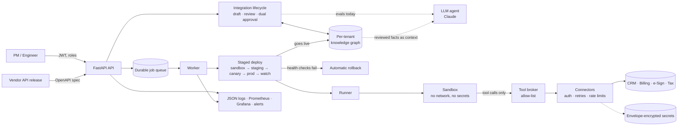

# Agentic Integration Platform

**An AI agent that builds, ships and maintains your SaaS integrations, and remembers how *your* company does things.**

[Paper overview slides](https://anshulkummar.github.io/agentic-integration-platform/slides/) · [Live click-through demo](https://anshulkummar.github.io/agentic-integration-platform/) · [Try it in 5 minutes](#try-it-in-5-minutes) · [Use it as a framework](#use-it-as-a-framework) · [Technical details](#technical-details-for-engineers)

This repository accompanies the paper *Agentic integration of platform APIs for digital product management* (PMAIP), by Shiv Yadav, Anshul Kumar and Nitin Joglekar (DSI 2026). It contains:

- a [click-through presentation](https://anshulkummar.github.io/agentic-integration-platform/slides/) of the paper, the KG demo and the measured results (use ← / →; it also works on phones);
- the clickable demo shown at the conference;
- a working, multi-tenant platform that implements the paper's ideas end to end;
- the evaluation data behind every number below.

---

## The problem

Every company's product depends on connecting SaaS tools: CRM, billing, ERP, e-signature, tax, and more. Today that work is:

- **Slow.** A product manager writes a ticket. An engineer reads two vendors' API docs, maps fields by hand, writes glue code, tests it and ships it, often weeks later.
- **Fragile.** Vendors change their APIs. Deprecated fields silently break integrations, and roadmap items stay blocked until someone notices that a new API version unblocks them.
- **Dependent on tribal knowledge.** "Our ERP wants the *legal* company name, not the display name." "Never sync the sales rep; the ERP assigns it." "Field `UDF_07` is our sales region." These rules live in people's heads and get re-learned, or re-broken, on every integration.

## What the platform does

| For the… | The agent… |
|---|---|
| **Product manager** | turns a plain-English intent ("connect CRM to billing so closed-won accounts become customers, with tax") into a reviewable integration. |
| **Engineer** | gets a draft with field mappings, runnable code, risks and tests. They correct only what is wrong; every correction is remembered. |
| **Both** | must approve (product *and* engineering) before anything ships. The author can't approve their own work. |
| **Operations** | sees every release go sandbox → staging → canary → production, guarded by real health checks. A vendor outage triggers an **automatic rollback**. |
| **The roadmap** | is watched continuously. When a vendor ships a new API version, the agent works out what changed, flags deprecated fields, finds the roadmap item it unblocks and **drafts that integration on its own**. |

## The knowledge graph: your company's integration memory

The knowledge graph (KG) is what turns a generic AI agent into one that knows how *your company* does things. It stores:

| What it knows | Example in a company |
|---|---|
| Your systems, business objects and fields | CRM `Account`, Billing `Customer`, ERP `SalesOrder` |
| Your roadmap and what blocks it | "Contract-to-cash is blocked until e-signature has a *completed* event" |
| Reusable integration patterns | how CRM→billing integrations are built here |
| **Your reviewed decisions and house rules** | "customer name = legal registered name", "annual value excludes tax", "`UDF_07` holds the sales region", "sales rep is assigned by the ERP, leave it empty" |
| API changes and deprecations | "`Envelope.signer_email` is replaced by `Agreement.signers[].email`" |

How it gets used:

1. **Every human review teaches it.** When an engineer fixes a mapping, that decision becomes a fact in the KG. No training run, no prompt engineering.
2. **The next integration starts from what the company already decided.** The platform's drafting agent reuses the learned patterns and rules, so the same correction isn't needed twice. In the evals we also gave these reviewed facts to Claude as context; that is the experiment measured below, and it isn't yet wired into the platform's drafting endpoint (see [Limitations](#limitations)).
3. **It is per company.** Each customer org has its own KG, so one company's conventions never leak into another's.
4. **It is auditable.** Every fact traces back to a reviewed, approved, deployed integration, and learning can be switched off per company.

### What we measured

All numbers come from the eval suite in this repo (`app/platform/evals`). The run reports, including cost and token counts, are in [`reports/evals/`](reports/evals). Edits are the field-mapping corrections a human reviewer has to make.

| Question | Result |
|---|---|
| How good is a classic name-matching approach? | **18.5%** of fields right on realistic cases (12 corrections per integration). |
| How good is the LLM agent alone (Claude)? | **97.1%** on realistic cases (0.5 corrections per integration), about **23× fewer corrections**. Its confidence scores can be trusted: every mapping it rated ≥ 0.8 was correct. |
| Does the KG help on things the LLM already knows, such as public-API field meanings? | **No measurable difference.** There is nothing left to fix. |
| **Does the KG teach the agent a company's own conventions?** | **Yes.** Without the KG the agent gets company-specific fields right about half the time: **3.7 mistakes per integration**, the same on every integration. With the KG, after **one** reviewed integration it drops to **0.4, then 0.0, 0.25 and 0.0** on the next ones. That saves **3.5 corrections per integration** (95% CI 3.3–3.7). Fields the LLM already knew were unaffected. |

The company-conventions experiment was pre-registered: its design and success criterion were committed before any run (`app/platform/evals/conventions.py`). Its limitations are stated plainly:

- The conventions were synthetic and perfectly consistent; real companies have exceptions and drift.
- One model and one human labeler were used.
- The learning is "learn the house rule after one review", not a curve that keeps compounding.

All the live LLM runs together cost about **$5**.

### A day in the life (the demo's two loops)

1. **Loop 1, intent-driven:**
   - A PM asks for CRM → billing with tax.
   - The agent drafts 6 mappings and the code.
   - An engineer fixes 3 (currency format, payment terms, tax jurisdiction).
   - Product and engineering approve.
   - It ships through canary to production.
   - The KG learns the pattern and the 3 rules.
2. **Loop 2, agent-initiated:**
   - The e-signature vendor releases API v3.0.
   - The agent diffs the spec and flags a deprecated field.
   - It sees that the release unblocks the *Contract-to-cash* roadmap item (fit 0.91).
   - It drafts that integration itself, with **7 of 9 mappings reused from what the engineer taught it**.
   - It waits for approval.

With learning switched off, the same draft reuses 0.

### Is it production-ready?

It is a **deploy-ready reference implementation**, not a hardened product.

**Done:**
- Login and roles.
- Tenant isolation, including PostgreSQL row-level security.
- Encrypted secrets.
- Sandboxed code execution: a Docker backend with no network access.
- Staged deploys with automatic rollback.
- Metrics, alerts and dashboards.
- Migrations and CI.

**Not yet:**
- An admin web console (it's API-only for now).
- Connections to real vendor sandboxes (it uses realistic simulators).
- Load testing, a penetration test or a compliance audit.
- Login rate limiting shared across instances.
- Outbound URL allow-listing to guard against SSRF.

See [Limitations](#limitations).

---

## Try it in 5 minutes

You need **Python 3.12** and git. It's tested on 3.12; newer versions are untested. No Docker, database server or API key is required.

```bash
git clone https://github.com/AnshulKummar/agentic-integration-platform.git
cd agentic-integration-platform
python -m venv .venv
# Windows: .venv\Scripts\activate    macOS/Linux: source .venv/bin/activate
pip install -r requirements-platform.txt
```

```bash
python -m app.platform.quickstart
```

The walkthrough runs the real code paths:
- sign-up and roles;
- encrypted vendor credentials;
- connectors generated from each vendor's OpenAPI spec;
- loop 1 deployed through the sandbox to production against vendor simulators over real HTTP;
- the KG learning from it;
- loop 2 drafted by the agent.

It takes about 10 seconds. Time is simulated for the canary windows; everything else is real.

```bash
python -m app.platform.quickstart --no-learning
```

This is the same story with KG learning off: loop 2 reuses nothing.

More ways to explore:

| What | Command |
|---|---|
| The API with interactive docs | `uvicorn app.platform.main:app`, then open http://127.0.0.1:8000/docs |
| The conference click-through UI | `cd demo && npm ci && npm run dev` (or use the [live link](https://anshulkummar.github.io/agentic-integration-platform/)) |
| The paper-overview slides | [live link](https://anshulkummar.github.io/agentic-integration-platform/slides/); source: `demo/public/slides/index.html` |
| The full stack (Postgres, worker, simulators, Prometheus, Grafana) | `cp .env.platform.example .env.platform`, fill it in, then `docker compose -f docker-compose.platform.yml --env-file .env.platform up --build` |
| The mapping evals, free and deterministic | `python -m app.platform.evals run --suite all` |
| The live LLM evals (needs `ANTHROPIC_API_KEY`; hard cost cap) | `PLATFORM_EVAL_COST_CAP_USD=5 python -m app.platform.evals run --predictor live_llm` |
| The company-conventions KG experiment, about $2 | `python -m app.platform.evals conventions --replicates 3` |

---

## Use it as a framework

The repo is meant to be cloned and adapted. These are the common extension points:

| You want to… | Do this |
|---|---|
| **Connect a new SaaS vendor** | `PUT /v1/connections/{system}` with the vendor's OpenAPI spec and an auth config naming stored secrets (`api_key`, `bearer` or `oauth2_client_credentials`). Agent tools are generated from the spec automatically; retries, rate limits, paging and idempotency are handled. |
| **Store vendor credentials** | `PUT /v1/secrets/{name}`. Secrets are write-only, envelope-encrypted per tenant, and only ever reach a connector at call time. |
| **Seed your own systems and roadmap** | `POST /v1/kg/bootstrap` loads `app/demo/fixtures/seed.json`; replace it with your systems, objects, fields and roadmap. `/v1/roadmap` manages items. |
| **Encode your house rules as a test** | Copy `app/platform/evals/conventions.py`, write your company's real conventions, and measure how many corrections the KG saves *you*. |
| **Swap the LLM** | `PLATFORM_LLM_MODEL` (default `claude-opus-5-5`). |
| **Use your cloud KMS** | Implement the `KeyProvider` protocol in `app/platform/secrets/crypto.py`. |
| **Change the code sandbox** | Implement the `Sandbox` protocol in `app/platform/interfaces.py`, e.g. gVisor, Firecracker or Kubernetes Jobs. |
| **Tune rollout safety** | `PLATFORM_CANARY_PERCENT`, `PLATFORM_CANARY_MAX_ERROR_RATE`, `PLATFORM_CANARY_MAX_P95_MS` and `PLATFORM_POST_DEPLOY_WATCH_S`. |
| **Use a different identity provider** | Replace `current_principal` in `app/platform/principal.py`; every route depends only on it. |

License: MIT (see [LICENSE](LICENSE)).

---

## Technical details (for engineers)

### Architecture



### Repository map

| Path | What it is |
|---|---|
| `app/platform/` | **The production platform** (the code this README describes). |
| `app/platform/auth/` | Users, memberships, argon2 passwords, JWT + rotating refresh tokens with reuse detection, rate limiting, PostgreSQL row-level security. |
| `app/platform/integrations/` | The two PMAIP loops: KG persistence, drafting from intent, review edits, dual approval with separation of duties, API-release ingestion, roadmap matching. |
| `app/platform/secrets/` | AES-256-GCM envelope encryption, key rotation, log redaction. |
| `app/platform/connectors/` | HTTP connectors generated from OpenAPI (REST → agent tools). |
| `app/platform/sandbox/` | Runnable codegen, AST validator, tool broker, subprocess and Docker backends, runner. |
| `app/platform/deployments/` | Stage machine, canary routing, health checks, auto-rollback, lifecycle hooks, job queue. |
| `app/platform/observability/` | Structured logs, request IDs, Prometheus metrics, `/healthz`, `/readyz`, `/metrics`. |
| `app/platform/evals/` | Datasets, predictors, metrics, learning curves, the conventions experiment, the CI gate. |
| `app/platform/simulators/` | CRM, e-signature and billing simulators: OAuth, rate limits, signed webhooks, fault injection. |
| `app/platform/quickstart.py` | The 5-minute walkthrough (also run as a test). |
| `app/demo/` | Domain logic shared with the conference demo: schema alignment, mapping drafter, KG learning, OpenAPI diff. |
| `demo/` | The click-through UI (React + Vite) and the slides (`demo/public/slides/`), deployed to GitHub Pages. |
| `deploy/` | Prometheus, Alertmanager, Grafana and Postgres role setup. |
| `reports/evals/` | Every eval report behind the numbers above. |
| `app/api`, `app/services`, `frontend/`, … | The upstream project this was forked from (see [Origins](#origins)); not used by the platform. |

### How a request flows

1. **Auth:** a bearer JWT resolves to a `Principal`, scoped to one tenant. Every database session is bound to that tenant: reads are filtered automatically, cross-tenant writes are rejected, and PostgreSQL RLS is a third layer.
2. **Drafting:**
   - The tenant's KG is loaded, and the mapping drafter proposes mappings, reusing learned patterns and rules.
   - The LLM path with reviewed KG facts as context is measured in `app/platform/evals` but not yet wired in here.
   - The sandbox codegen renders the reviewable `def run(event, tools)` module, and the version's `allowed_tools` are derived from the same plan, so what is approved is exactly what runs.
3. **Deploying:**
   - The worker advances the stages. Each stage runs synthetic transactions in the sandbox, checks connector health, and evaluates error-rate and p95 limits on real executions; the canary is compared with the baseline.
   - A breach fails the deploy before production, or rolls back during canary or the post-deploy watch.
   - Going live fires the `on_live` hook, and the KG learns.
4. **Executing:**
   - Generated code runs in a child process or container with no network and no secrets.
   - Its only way out is `tools.call(...)`, which reaches a host-side broker that enforces the allow-list and call budget and calls the connector with the tenant's decrypted credentials.

### Security model (summary)

- **Passwords and sessions:** argon2 password hashing; short-lived access tokens; refresh-token rotation with reuse detection.
- **Approvals:** roles are admin, PM, engineer and viewer. Approvals require separation of duties.
- **Tenant isolation:** enforced by the ORM, the repositories and PostgreSQL RLS. Another tenant's IDs return 404, never 403.
- **Secrets:**
  - Never returned or logged; redaction filters are active.
  - Each value is encrypted with its own data key, bound to its tenant and name, and data keys are wrapped by a master key.
- **Generated code:**
  - Checked against an AST allow-list before it runs.
  - Docker sandbox flags: `--network none --read-only --cap-drop ALL --user 65534 --pids-limit --memory`.
  - The subprocess backend is for development only; production config refuses to start without Docker.
- **Production safety:** production refuses unsafe config, such as missing secrets, SQLite, the subprocess sandbox, or auto-created schemas.

### Configuration

All settings are `PLATFORM_*` environment variables (`app/platform/config.py`). The important ones:

| Variable | Default | Notes |
|---|---|---|
| `PLATFORM_ENV` | `development` | `production` enforces safe config. |
| `PLATFORM_DATABASE_URL` | `sqlite+aiosqlite:///./platform.db` | Use `postgresql+asyncpg://…` in production. |
| `PLATFORM_JWT_SECRET` / `PLATFORM_MASTER_KEY` | ephemeral in development | Required in production; see `.env.platform.example`. |
| `PLATFORM_SANDBOX_BACKEND` | `subprocess` | Must be `docker` in production. |
| `PLATFORM_CANARY_PERCENT` | `10` | Share of live events sent to the canary. |
| `PLATFORM_LLM_MODEL` / `ANTHROPIC_API_KEY` | `claude-opus-5-5` / unset | Live LLM drafting and evals. |
| `PLATFORM_EVAL_COST_CAP_USD` | `5.0` | Hard stop for live eval spend. |

### Tests and CI

```bash
python -m pytest -c tests/platform/pytest.ini tests/platform   # 394 tests (+6 that need Docker/Postgres/API key)
python -m pytest -c tests/demo/pytest.ini tests/demo           # 37 demo-backend tests
cd demo && npm test                                            # 27 UI tests
```

The `Platform CI` workflow runs these jobs:
- `ruff` and `mypy --strict`;
- the full suite on SQLite and on PostgreSQL;
- migrations up and down, including RLS;
- the Docker sandbox tests;
- the eval regression gate;
- a production image build that must refuse unsafe config.

### Evals: reproducing the numbers

| Command | Measures | Cost |
|---|---|---|
| `python -m app.platform.evals run --suite all` | The deterministic baseline (name matching + KG patterns) | free |
| `python -m app.platform.evals curve --suite all` | KG learning on vs off, deterministic | free |
| `python -m app.platform.evals run --predictor live_llm` | Claude alone | about $1.3 |
| `python -m app.platform.evals curve --predictor live_llm_kg` | Claude with vs without KG context | about $2.2 |
| `python -m app.platform.evals conventions --replicates 3` | The pre-registered company-conventions test | about $1.8 |

The suites:
- **Synthetic:** 72 generated cases.
- **Hand-labeled:** 19 cases and 318 labeled target fields, modelled on public CRM, ERP, e-signature and tax APIs.
- **Conventions:** 4 companies × 5 integrations, each company with 6 house rules.

### Limitations

- **The headline LLM + KG results come from the eval harness.** The platform's `POST /v1/integrations` still drafts with the deterministic drafter plus KG patterns. Wiring the `live_llm_kg` predictor (Claude with reviewed KG facts as context) into drafting is the next step.
- The LLM results are from one model, single runs per configuration (3 replicates for the conventions test), and a dataset with a single labeler.
- The vendor APIs are simulated. Pointing connections at real vendor sandboxes is configuration, not code, but it hasn't been done here.
- Synthetic deploy checks call whatever API a connection points at. Use vendor sandbox accounts for staging connections.
- There is no web console for approvals yet; approvals happen through the API.
- Several pieces are single-instance or missing:
  - login rate limiting is in-memory per instance;
  - there is no SSRF guard on connection URLs;
  - there is no endpoint for creating version 2+ of an integration;
  - a canary with very little traffic waits indefinitely.

### Origins

This is a fork of [shivyadavus/agentic-integration-platform](https://github.com/shivyadavus/agentic-integration-platform). The upstream README is preserved in [`docs/UPSTREAM_README.md`](docs/UPSTREAM_README.md). The PMAIP platform (`app/platform/`), the conference demo (`demo/`, `app/demo/`) and the evals were added for the DSI 2026 paper.
